# SweetBuzz Honey Pot — Attack Detection & Monitoring Platform

**Technical Design, Deployment, and Validation Report**

| | |
|---|---|
| **Project** | Honey Pot Attack Capture with Wazuh SIEM |
| **Version** | 1.0 |
| **Date** | 2026-10-19 |
| **Classification** | Internal / Lab |
| **Platform** | Ubuntu 25.04 · Wazuh 4.14.9 · VirtualBox |
| **Prepared by** | Security Engineering |

---

## Executive Summary

This report documents the end-to-end design, deployment, and validation of an end-to-end security
monitoring platform built around a deliberately vulnerable web application (**SweetBuzz Honey
Co.**) and the open-source **Wazuh** SIEM. The platform detects, in real time, two broad classes
of adversary activity:

1. **Web application attacks** — SQL injection, authentication bypass, cross-site scripting,
   HTTP method tampering, sensitive-path probing, command injection, and scanner/brute-force
   reconnaissance.
2. **Host privilege escalation** — modification of identity and authentication files, sudoers
   tampering, persistence via cron, `LD_PRELOAD` rootkit techniques, privileged command
   execution, capability/setuid abuse, `ptrace`, and kernel-level operations.

Detection was implemented through a custom log decoder, **22 purpose-built Wazuh rules**, **25 audit
subsystem rules**, and file-integrity monitoring. The platform was validated end-to-end against two
live virtual machines, producing **256 alerts across 13 distinct detection rules**, confirming
that every engineered detection fires correctly through the full telemetry pipeline
(honey pot → agent → manager → alert).

Deployment is fully automated and reproducible through two idempotent provisioning scripts
(`srv01.sh`, `nix01.sh`), allowing the entire environment to be rebuilt from scratch.

---

## Table of Contents

1. [Setting Up the SRV01 VM](#1-setting-up-the-srv01-vm)
2. [Installing the Wazuh Server](#2-installing-the-wazuh-server)
3. [Setting Up the NIX01 VM](#3-setting-up-the-nix01-vm)
4. [Developing the Honey Pot Web Application](#4-developing-the-honey-pot-web-application-sweetbuzz-honey-co)
5. [Deployment on NIX01](#5-deployment-on-nix01)
6. [Enrolling NIX01 as a Wazuh Agent](#6-enrolling-nix01-as-a-wazuh-agent)
7. [Capturing Web Attacks (Access Logging)](#7-capturing-web-attacks-honeypot-access-logging)
8. [Capturing Privilege Escalation (auditd + FIM)](#8-capturing-privilege-escalation-auditd--fim)
9. [Writing the Custom Decoder (SRV01)](#9-writing-the-custom-decoder-srv01)
10. [Writing the Detection Rules (SRV01)](#10-writing-the-detection-rules-srv01)
11. [Validating the Rules](#11-validating-the-rules)
12. [Live Attack Testing (End-to-End)](#12-live-attack-testing-end-to-end)
13. [Operations Runbook](#13-operations-runbook)
14. [Architecture Overview](#14-architecture-overview)
15. [Laboratory Environment](#15-laboratory-environment)
16. [Automated Provisioning Scripts](#16-automated-provisioning-scripts)
17. [Appendices](#17-appendices)

---

## 1. Setting Up the SRV01 VM

To begin, we create the **SRV01** virtual machine, running **Ubuntu Server**, which serves as the
host for the Wazuh SIEM security server.

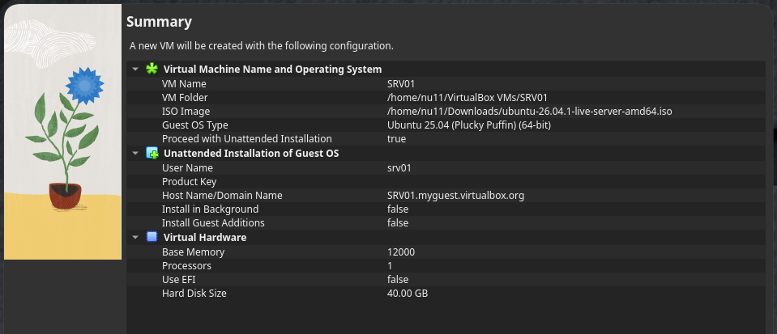

Once the VM has been created, click **Start** to power it on.

After installation completes, sign in to **SRV01** using the following credentials:

| Field    | Value       |
|----------|-------------|
| Username | `srv01`     |
| Password | `P@ssword`  |

Next, ensure the system is fully up to date before installing any security software:

```bash
sudo apt update && sudo apt upgrade -y
```

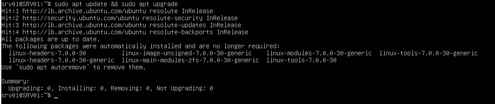

> **Note.** Keeping the base image current avoids dependency conflicts during the Wazuh install
> and ensures the latest security patches are applied to the monitoring server itself — a
> management host should never be the weakest link in the environment.

**Host-only network.** SRV01 is attached to the VirtualBox host-only network `vboxnet0` on
`192.168.56.102`. A NAT port-forward `2223 → SRV01:22` is configured for remote administration
during testing.

---

## 2. Installing the Wazuh Server

With the system up to date, we proceed with the Wazuh server installation. Wazuh bundles three
cooperating components: the **manager** (analysis and rule engine), the **indexer**
(OpenSearch-based storage), and the **dashboard** (visualisation).

### Step 1: Download the Wazuh Installation Assistant

Download the official installation assistant and make it executable:

```bash
curl -sO https://packages.wazuh.com/4.14/wazuh-install.sh
chmod +x wazuh-install.sh
```

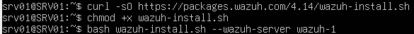

### Step 2: Run the Wazuh Installation Assistant

Execute the assistant in all-in-one mode (`-a`) with an interactive prompt (`-i`):

```bash
sudo bash wazuh-install.sh -a -i
```

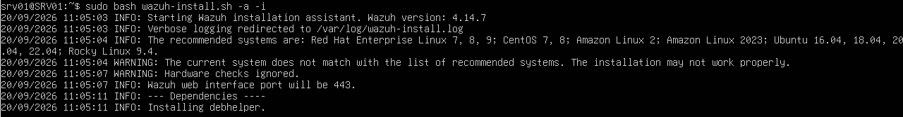
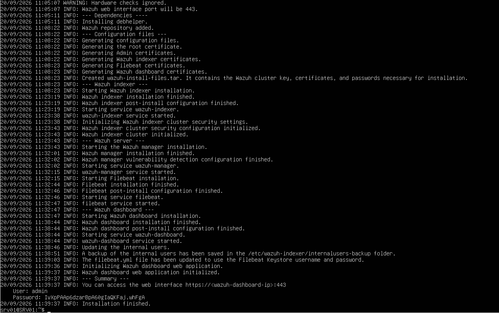

> **What this does.** The `-a` flag installs the manager, indexer, and dashboard on a single host;
> `-i` prompts for the initial `admin` password. When complete, the assistant prints the dashboard
> URL and credentials.

### Step 3: Save Wazuh Server Credentials

Persist the generated credentials for later use:

```bash
echo username:password > creds.txt
cat creds.txt
```

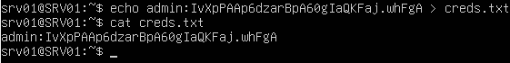

### Step 4: Verify the Installation

Confirm the manager is running and reachable before continuing:

```bash
sudo systemctl status wazuh-manager --no-pager
sudo /var/ossec/bin/wazuh-control info
```

The dashboard is available at:

```
https://192.168.56.102/
```

---

## 3. Setting Up the NIX01 VM

We create a second Ubuntu Server VM named **NIX01** to host the honey pot and a Wazuh agent. This
VM is intentionally placed on the same host-only network so the agent can reach the manager
directly.

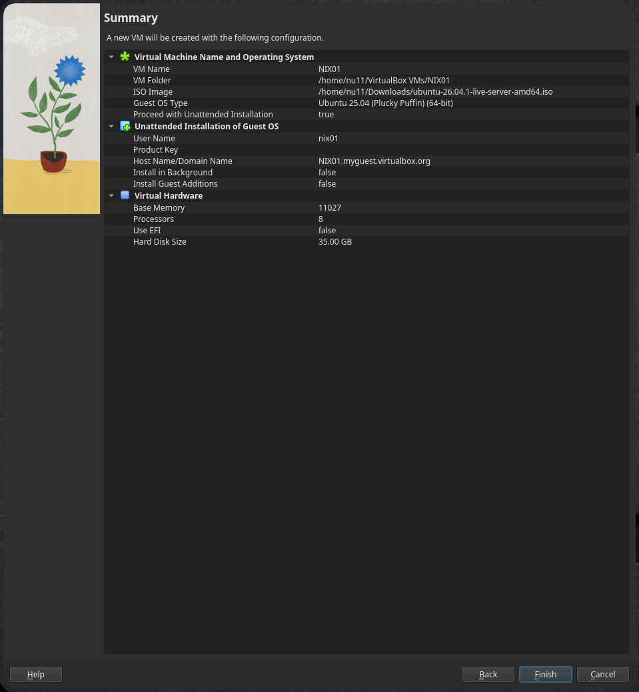

| Field    | Value       |
|----------|-------------|
| Hostname | `NIX01`     |
| Username | `nix01`     |
| Password | `P@ssword`  |
| IP       | `192.168.56.101` |

> **Note.** In our lab the NAT port-forward `2222 → NIX01:22` and the application forward
> `5000 → NIX01:5000` are configured in the VirtualBox network settings for remote access during
> testing. The host-only address `192.168.56.101` is used for agent-to-manager communication.

---

## 4. Developing the Honey Pot Web Application ("SweetBuzz Honey Co.")

We developed a custom, professional artisanal honey e-commerce web application named **SweetBuzz
Honey Co.** designed to test security monitoring, intrusion detection (Wazuh), and analyze common
web attack vectors.

### Application Architecture & Vulnerabilities

Built with Python (Flask) and SQLite, the application features a warm amber/gold aesthetic and
incorporates **three deliberate security vulnerabilities**, each mapped to a well-known attack
class:

| ID | Vulnerability | Endpoint | CWE | OWASP 2021 |
|----|---------------|----------|-----|------------|
| V1 | SQL Injection (auth bypass) | `POST /login` | CWE-89 | A03 Injection |
| V2 | HTTP Method Tampering | `DELETE /admin` | CWE-650 | A01 Broken Access Control |
| V3 | Stored Cross-Site Scripting | `POST /feedback` | CWE-79 | A03 Injection |

---

### Vulnerability 1: SQL Injection (Login Portal)

The login route constructs SQL queries dynamically using user input without sanitization or
parameterization.

**Vulnerable Code Snippet (`app.py`):**

```python
@app.route('/login', methods=['GET', 'POST'])
def login():
    error = None
    if request.method == 'POST':
        username = request.form.get('username', '')
        password = request.form.get('password', '')

        conn = sqlite3.connect(DB_PATH)
        cursor = conn.cursor()

        # VULNERABLE SQL QUERY (SQLi)
        query = f"SELECT id, username, is_admin FROM users WHERE username = '{username}' AND password = '{password}'"
        cursor.execute(query)
        user = cursor.fetchone()
        ...
```

**Exploitation Steps:**

1. Navigate to `http://192.168.56.101:5000/login`.
2. In the **Username** field, enter the SQL payload:
   ```sql
   admin' --
   ```
3. Leave password blank or enter anything.
4. The query evaluates to: `SELECT ... WHERE username = 'admin' --' AND password = '...'`.
5. Authentication bypasses successfully, granting access to the VIP dashboard and flag:
   `CODEBY{HONEYPOT_SQLI_BYPASS_SUCCESS}`.

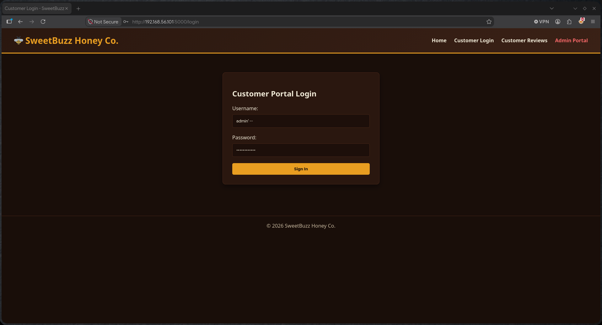

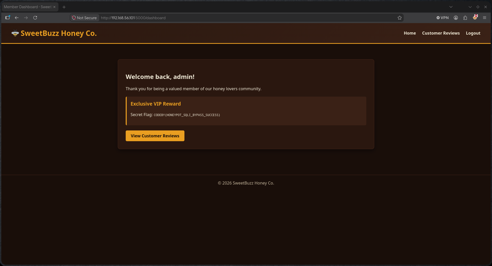

> **Impact.** Because the query is built by string interpolation, the `--` sequence comments out
> the remainder of the statement, including the password check. This yields an authentication
> bypass for any known username.

---

### Vulnerability 2: HTTP Method Tampering & Honeypot Trap (Admin Panel)

The `/admin` route presents a login form on `GET` and rejects password submissions on `POST`
(acting as a honeypot trap). However, the `DELETE` method lacks authorization checks and grants
administrative access.

**Vulnerable Code Snippet (`app.py`):**

```python
@app.route('/admin', methods=['GET', 'POST', 'PUT', 'DELETE'])
def admin():
    if request.method == 'GET':
        return render_template_string('...Admin Login Form (Trap)...')
    elif request.method == 'POST':
        return render_template_string('...Access Denied...'), 403
    elif request.method == 'DELETE':
        # Method Tampering Bypass!
        return "<h1>Admin Authorization Bypassed. Flag: CODEBY{METHOD_TAMPERING_MASTER}</h1>"
```

**Exploitation Steps:**

1. Visiting `http://192.168.56.101:5000/admin` shows the admin login form (the trap). Entering a
   password results in access denied.
2. Use `curl` or Burp Suite to send an HTTP `DELETE` request instead of `GET` or `POST`:
   ```bash
   curl -X DELETE http://192.168.56.101:5000/admin
   ```
3. The server responds with the administrative flag: `CODEBY{METHOD_TAMPERING_MASTER}`.

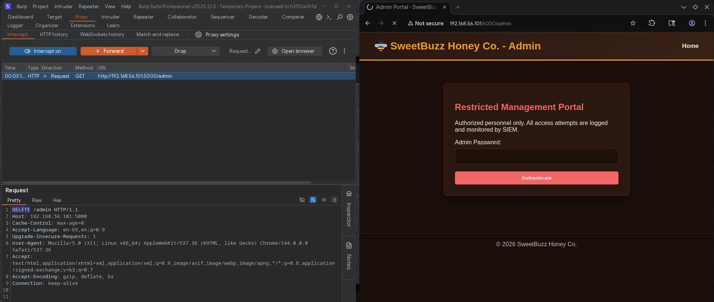

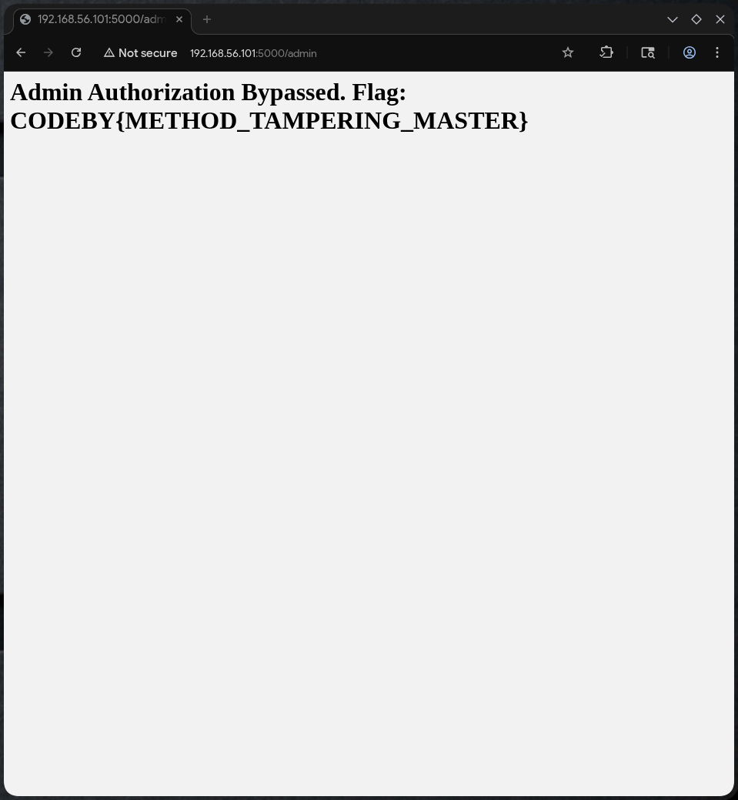

> **Impact.** The developer assumed the UI would only ever issue `GET`/`POST`, so the `DELETE`
> branch (an internal maintenance path) was left unauthenticated. This is a classic example of
> relying on the client to enforce the allowed method set.

---

### Vulnerability 3: Stored Cross-Site Scripting (Customer Reviews)

The feedback endpoint stores user comments and renders them using `|safe` without HTML escaping,
leading to Stored XSS.

**Vulnerable Code Snippet (`app.py`):**

```python
@app.route('/feedback', methods=['GET', 'POST'])
def feedback():
    conn = sqlite3.connect(DB_PATH)
    cursor = conn.cursor()
    if request.method == 'POST':
        name = request.form.get('name', 'Anonymous')
        comment = request.form.get('comment', '')
        cursor.execute("INSERT INTO feedback (name, comment) VALUES (?, ?)", (name, comment))
        conn.commit()
    ...
    return render_template_string('''
        ...
        
            <h4>{{ f[0] }}</h4>
            <p>{{ f[1]|safe }}</p>
        
    ''', feedbacks=feedbacks)
```

**Exploitation Steps:**

1. Navigate to `http://192.168.56.101:5000/feedback`.
2. Enter your name and submit an HTML/JavaScript payload in the comment field:
   ```html
   <script>alert('XSS Cookie: ' + document.cookie);</script>
   ```
3. The payload is stored in the database and executed in the browser of anyone visiting the
   reviews page.

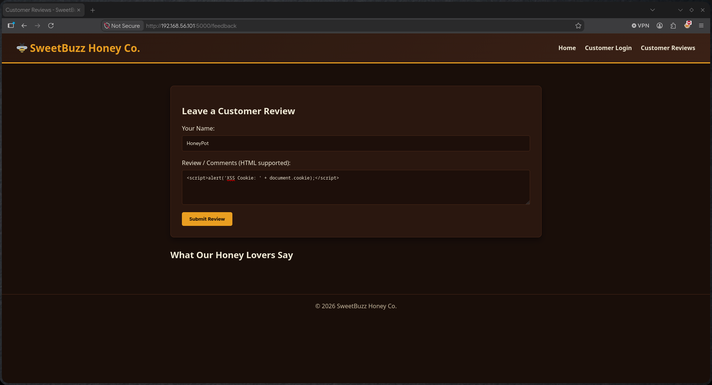

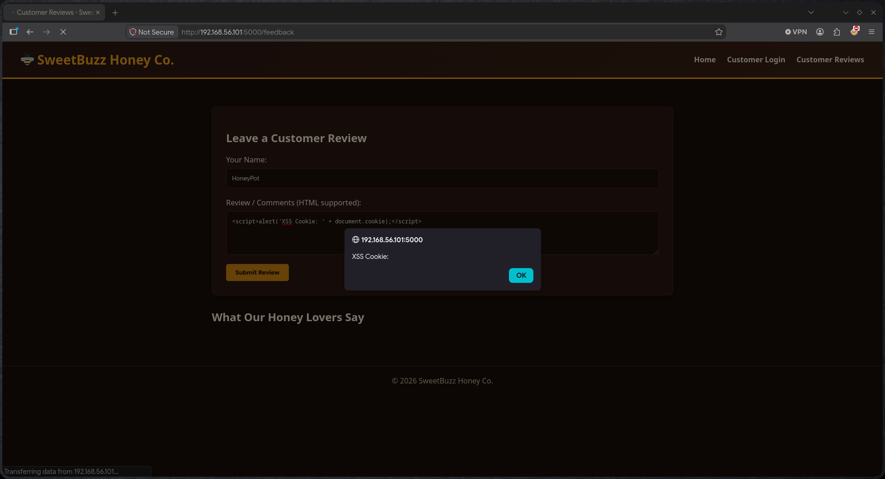

> **Impact.** The Jinja2 `|safe` filter disables auto-escaping, so the stored script runs with the
> victim's session context — enabling session theft or drive-by actions on every visitor.

---

## 5. Deployment on NIX01

To deploy the application as a persistent systemd service on **NIX01** (`192.168.56.101`):

```bash
# Push application to NIX01
scp -r honeypot_app nix01@192.168.56.101:/home/nix01/

# SSH and execute deployment script
ssh nix01@192.168.56.101
cd honeypot_app
chmod +x deploy.sh
./deploy.sh
```

The deployment script creates a Python virtual environment, installs the Flask dependency, and
registers the application as a systemd service (`honeypot.service`) that restarts automatically.

The application runs persistently via systemd and is accessible at `http://192.168.56.101:5000/`.

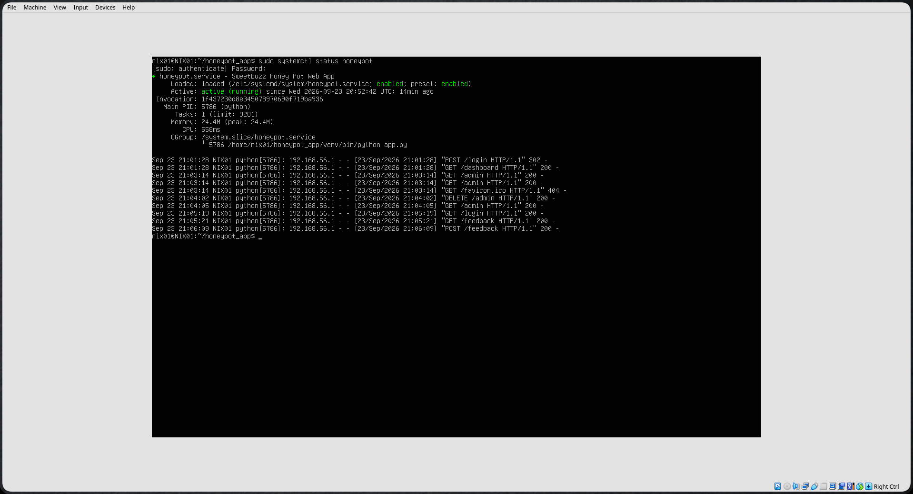

**Verification:**

```bash
systemctl status honeypot --no-pager
curl -s -o /dev/null -w "HTTP %{http_code}\n" http://127.0.0.1:5000/
```

> **Note.** The service is configured with `Restart=always` and `WantedBy=multi-user.target`, so it
> survives crashes and reboots without manual intervention.

---

## 6. Enrolling NIX01 as a Wazuh Agent

With the honey pot running on **NIX01**, the next step is to connect it to the **SRV01** Wazuh
manager so that all honey pot and host activity is forwarded for detection.

### Step 1: Verify the Wazuh Manager

Confirm the manager version and that only the local agent (`000`) is currently enrolled:

```bash
sudo /var/ossec/bin/wazuh-control info
sudo /var/ossec/bin/agent_control -l
```

The running manager is **Wazuh 4.14.9**.

### Step 2: Add the Wazuh Apt Repository on NIX01

The correct repository path is `packages.wazuh.com/4.x/apt/` (note: `4.14/apt/` returns **403**):

```bash
curl -s https://packages.wazuh.com/key/GPG-KEY-WAZUH | sudo gpg --no-default-keyring \
  --keyring gnupg-ring:/usr/share/keyrings/wazuh.gpg --import
sudo chmod 644 /usr/share/keyrings/wazuh.gpg
echo "deb [signed-by=/usr/share/keyrings/wazuh.gpg] https://packages.wazuh.com/4.x/apt/ stable main" \
  | sudo tee /etc/apt/sources.list.d/wazuh.list
sudo apt update
```

### Step 3: Install the Wazuh Agent

```bash
sudo apt install -y wazuh-agent=4.14.9-1
```

*(If the direct package URL returns 403 to non-browser clients, the `.deb` can be pulled from the
repository index at `pool/main/w/wazuh-agent/wazuh-agent_4.14.9-1_amd64.deb` — approx. 13.5 MB.)*

### Step 4: Enroll the Agent with the Manager

Point the agent at the manager's host-only IP (`192.168.56.102`) and register the name `NIX01`:

```bash
sudo /var/ossec/bin/agent-auth -m 192.168.56.102 -A NIX01
sudo systemctl enable --now wazuh-agent
```

The manager now lists **NIX01** as agent `001` with status **Active**:

```bash
sudo /var/ossec/bin/agent_control -l
```

**Expected result:**

```
   ID: 001, Name: NIX01, IP: any, Active
```

> **Troubleshooting.** If enrollment fails, verify the manager is reachable on TCP 1515
> (`nc -zv 192.168.56.102 1515`) and that DNS/time are correct on the agent. A clock skew of more
> than a few minutes will break the key exchange.

---

## 7. Capturing Web Attacks (Honeypot Access Logging)

By default the SweetBuzz application produces no machine-readable request log. We added a
lightweight logging hook so every request can be decoded and detected by Wazuh.

### Step 1: Add the Access-Log Hook to `app.py`

A Flask `@app.after_request` handler appends one line per request to
`~/honeypot_app/logs/access.log` in a deliberately token-safe, single-line format:

```python
@app.after_request
def _hp_access_log(resp):
    src  = request.headers.get("X-Forwarded-For", request.remote_addr) or "-"
    q    = request.query_string.decode("utf-8", "replace")
    body = ""
    if request.method in ("POST", "PUT", "PATCH", "DELETE"):
        if request.form:
            body = "&".join("%s=%s" % (k, v) for k, v in request.form.items())
        else:
            body = request.get_data(cache=True, as_text=True)[:1500] or ""
    path    = request.path + ("?" + q if q else "")
    payload = body if body else q
    plain   = unquote_plus(str(payload))          # URL-decode once for detection
    line = ("HONEYPOT-ACCESS src=%s method=%s path=%s status=%d body=%s ua=%s\n"
            % (src.split(",")[0].strip(), request.method, _field(path),
               resp.status_code, _field(plain) or "-",
               _field(request.user_agent.string, 200)))
    with open(_ACCESS_LOG, "a") as _f:
        _f.write(line)
    return resp
```

**Encoding rules** ensure the value of any field never contains a space or quote (which would
break field parsing):

| Transformation | Purpose |
|----------------|---------|
| non-printable → `?` | keep the line printable |
| `%` → `%25` | prevent double-encoding ambiguity |
| space → `+` | keep tokens separated by single spaces |
| `"` → `%22` | avoid breaking the decoder regex |

### Step 2: Configure the Agent to Read the Log

Append a `<localfile>` entry in `/var/ossec/etc/ossec.conf` on NIX01:

```xml
<localfile>
  <log_format>syslog</log_format>
  <location>/home/nix01/honeypot_app/logs/access.log</location>
</localfile>
```

Then restart the agent:

```bash
sudo systemctl restart wazuh-agent
```

**Sample captured line:**

```
HONEYPOT-ACCESS src=10.0.2.2 method=POST path=/login status=200 body=username=admin'+--+&password=x ua=curl/8.21.0
```

> **Design note.** The payload is URL-decoded **once** before logging so detection rules match
> plaintext signatures (e.g. `UNION SELECT`) rather than their encoded forms.

---

## 8. Capturing Privilege Escalation (auditd + FIM)

To observe host-level attacks, we use the Linux **audit subsystem** for syscall and file-watch
events, and Wazuh's **file-integrity monitoring (FIM)** for real-time change detection.

### Step 1: Install and Configure auditd

```bash
sudo apt install -y auditd audispd-plugins
```

### Step 2: Deploy Custom Audit Rules

Create `/etc/audit/rules.d/honeypot-privesc.rules`:

```
-D
-b 8192
-w /etc/passwd -p wa -k hp_identity
-w /etc/shadow -p wa -k hp_identity
-w /etc/group -p wa -k hp_identity
-w /etc/gshadow -p wa -k hp_identity
-w /etc/sudoers -p wa -k hp_sudoers
-w /etc/sudoers.d -p wa -k hp_sudoers
-w /var/spool/cron -p wa -k hp_cron
-w /etc/crontab -p wa -k hp_cron
-w /etc/cron.d -p wa -k hp_cron
-w /etc/ld.so.preload -p wa -k hp_preload
-a always,exit -F arch=b64 -S execve -F exe=/usr/bin/sudo -k hp_exec
-a always,exit -F arch=b64 -S execve -F exe=/usr/bin/su -k hp_exec
-a always,exit -F arch=b64 -S execve -F exe=/usr/bin/passwd -k hp_exec
-a always,exit -F arch=b64 -S execve -F exe=/usr/sbin/useradd -k hp_exec
-a always,exit -F arch=b64 -S execve -F exe=/usr/sbin/usermod -k hp_exec
-a always,exit -F arch=b64 -S execve -F exe=/usr/sbin/groupadd -k hp_exec
-a always,exit -F arch=b64 -S execve -F exe=/usr/sbin/groupmod -k hp_exec
-a always,exit -F arch=b64 -S execve -F exe=/usr/bin/chsh -k hp_exec
-a always,exit -F arch=b64 -S execve -F exe=/usr/bin/find -k hp_find
-a always,exit -F arch=b64 -S setuid -F euid!=0 -k hp_setuid
-a always,exit -F arch=b64 -S setgid -F euid!=0 -k hp_setgid
-a always,exit -F arch=b64 -S capset -F euid!=0 -k hp_capset
-a always,exit -F arch=b64 -S ptrace -F euid!=0 -k hp_ptrace
-a always,exit -F arch=b64 -S mount -F euid!=0 -k hp_mount
-a always,exit -F arch=b64 -S delete_module -k hp_module
```

Load and verify (expect 25 loaded rules):

```bash
sudo augenrules --load
sudo auditctl -l | wc -l
```

> **Rule keys explained.** File watches use `-k hp_identity/sudoers/cron/preload`; process and
> syscall records use `-k hp_exec/find/setuid/setgid/capset/ptrace/mount/module`. These keys are
> what the Wazuh rules match on.

### Step 3: Enable File Integrity Monitoring, Rootcheck and SCA

Extend the agent's `ossec.conf` with real-time FIM on the honey pot application and sensitive
system files:

```xml
<syscheck>
  <disabled>no</disabled>
  <frequency>60</frequency>
  <directories check_all="yes" realtime="yes" report_changes="yes">/home/nix01/honeypot_app</directories>
  <directories check_all="yes" realtime="yes" report_changes="yes">/etc/passwd,/etc/shadow,/etc/group,/etc/sudoers,/etc/sudoers.d,/etc/crontab,/etc/cron.d,/root/.ssh,/home/nix01/.ssh</directories>
  <directories check_all="yes">/usr/bin,/usr/sbin</directories>
  <ignore type="sregex">honeypot.db$|logs/access.log$|\.pyc$</ignore>
</syscheck>

<rootcheck>
  <disabled>no</disabled>
  <frequency>300</frequency>
  <check_files>yes</check_files>
  <check_trojans>yes</check_trojans>
  <check_dev>yes</check_dev>
</rootcheck>

<sca>
  <enabled>yes</enabled>
  <scan_on_start>yes</scan_on_start>
  <interval>12h</interval>
</sca>
```

Also forward the audit log, auth log and syslog:

```xml
<localfile>
  <log_format>audit</log_format>
  <location>/var/log/audit/audit.log</location>
</localfile>
<localfile>
  <log_format>syslog</log_format>
  <location>/var/log/auth.log</location>
</localfile>
<localfile>
  <log_format>syslog</log_format>
  <location>/var/log/syslog</location>
</localfile>
```

Apply the change:

```bash
sudo systemctl restart wazuh-agent
```

> **Note.** FIM uses `realtime="yes"` on the honey pot and credential files so that changes are
> reported immediately rather than at the next scheduled scan. The `honeypot.db` and `access.log`
> files are deliberately ignored to prevent the database and log file from generating self-noise.

---

## 9. Writing the Custom Decoder (SRV01)

On the **SRV01** manager, create `/var/ossec/etc/decoders/honeypot_decoders.xml` to extract the
fields from the honey pot access log:

```xml
<decoder name="hp-access">
  <prematch>HONEYPOT-ACCESS </prematch>
  <regex>src=(\S+) method=(\S+) path=(\S+) status=(\d+) body=(\S+) ua=(\S+)</regex>
  <order>srcip,hpmethod,hppath,hpstatus,hpbody,hpua</order>
</decoder>
```

The captured fields are `srcip`, `hpmethod`, `hppath`, `hpstatus`, `hpbody` and `hpua`, which the
detection rules below reference.

| Field | Meaning |
|-------|---------|
| `srcip` | Source IP address |
| `hpmethod` | HTTP method |
| `hppath` | Request path (with query string) |
| `hpstatus` | HTTP response status |
| `hpbody` | Request body / query (URL-decoded once) |
| `hpua` | User-Agent string |

> **Design note.** A single `prematch` + full-line `regex` + `order` decoder was chosen after
> confirming that `program_name`-based matching is unreliable for agent-delivered custom logs.
> No literal quote characters appear in the regex, as these break field capture.

---

## 10. Writing the Detection Rules (SRV01)

Create `/var/ossec/etc/rules/honeypot_rules.xml` on **SRV01**. The rules cover both the web attacks
and the host privilege-escalation activity. All IDs are in the reserved `100000+` range.

### Web attack rules

```xml
<group name="honeypot,web,">

  <rule id="100100" level="0">
    <decoded_as>hp-access</decoded_as>
    <description>SweetBuzz access log base event.</description>
  </rule>

  <rule id="100111" level="12">
    <if_sid>100100</if_sid>
    <field name="hpbody" type="pcre2">(?i)(admin'[+\s%]*--|'[+\s]*or[+\s]+'?1|'[+\s]*or[+\s]+1[+\s]*=[+\s]*1|'[+\s]*--|%27[+\s%]*--|%27[+\s]*or)</field>
    <description>SweetBuzz authentication bypass / SQL injection in login (SQLi)</description>
    <mitre><id>T1078</id></mitre>
    <group>attack,sqli,authentication_failed,</group>
  </rule>

  <rule id="100110" level="12">
    <if_sid>100100</if_sid>
    <field name="hpbody" type="pcre2">(?i)(union[+%\s]*select|select[+%0-9a-f\s]{1,8}from|or[+\s]*1[+\s]*=[+\s]*1|sleep\(|benchmark\(|information_schema|xp_cmdshell|%27|%22|--[+\s])</field>
    <description>SQL injection attempt against SweetBuzz (SQLi)</description>
    <mitre><id>T1190</id></mitre>
    <group>attack,sqli,</group>
  </rule>

  <rule id="100112" level="12">
    <if_sid>100100</if_sid>
    <field name="hpua" type="pcre2">(?i)(sqlmap|nikto|nmap|nessus|acunetix|havij|masscan|gobuster|dirb|wfuzz|hydra|burp)</field>
    <description>Known attack tool / scanner user-agent detected on SweetBuzz</description>
    <mitre><id>T1595</id></mitre>
    <group>attack,recon,scanner,</group>
  </rule>

  <rule id="100120" level="10">
    <if_sid>100100</if_sid>
    <field name="hpbody" type="pcre2">(?i)(script|onerror|javascript:|document\.cookie|%3c|svG/onload|img[+\s]src)</field>
    <description>XSS / HTML injection payload submitted to SweetBuzz</description>
    <mitre><id>T1059.007</id></mitre>
    <group>attack,xss,</group>
  </rule>

  <rule id="100130" level="12">
    <if_sid>100100</if_sid>
    <field name="hpmethod" type="pcre2">^DELETE$|^PUT$|^PATCH$</field>
    <description>HTTP method tampering / admin honeypot trap triggered on /admin</description>
    <mitre><id>T1190</id></mitre>
    <group>attack,method_tampering,</group>
  </rule>

  <rule id="100140" level="6">
    <if_sid>100100</if_sid>
    <field name="hppath" type="pcre2">(?i)(\.env|\.git|wp-admin|phpmyadmin|\.aws|id_rsa|backup\.sql|\.bak|\.\./|%2e%2e)</field>
    <description>Honeypot probe for sensitive path/file</description>
    <mitre><id>T1595</id></mitre>
    <group>attack,recon,</group>
  </rule>

  <rule id="100150" level="12">
    <if_sid>100100</if_sid>
    <field name="hpbody" type="pcre2">(?i)(;|\||`|\$\(|&amp;&amp;)[+\s]*(whoami|id|cat|ls|curl|wget|nc|bash|sh|python)</field>
    <description>Potential command injection payload on SweetBuzz</description>
    <mitre><id>T1059</id></mitre>
    <group>attack,command_injection,</group>
  </rule>

  <rule id="100199" level="3">
    <if_sid>100100</if_sid>
    <field name="hpstatus" type="pcre2">^404$</field>
    <description>SweetBuzz 404 (probing)</description>
  </rule>

  <rule id="100191" level="8" frequency="8" timeframe="120">
    <if_matched_sid>100199</if_matched_sid>
    <same_source_ip />
    <description>Directory/file brute force against SweetBuzz (many 404s)</description>
    <mitre><id>T1595</id></mitre>
    <group>attack,recon,web_scan,</group>
  </rule>

  <rule id="100101" level="3">
    <if_sid>100100</if_sid>
    <description>SweetBuzz HTTP request</description>
  </rule>

</group>
```

### Privilege-escalation rules

```xml
<group name="honeypot,linux,privilege_escalation,">

  <rule id="100200" level="3">
    <if_sid>80700</if_sid>
    <field name="audit.key" type="pcre2">^hp_</field>
    <description>Honeypot audit event (key match)</description>
  </rule>

  <rule id="100210" level="8">
    <if_sid>80700</if_sid>
    <field name="audit.key" type="pcre2">^hp_identity$</field>
    <description>Identity file modified (/etc/passwd|shadow|group|gshadow) - possible privesc backdoor</description>
    <mitre><id>T1136.001</id></mitre>
    <group>attack,privilege_escalation,persistence,</group>
  </rule>

  <rule id="100211" level="10">
    <if_sid>80700</if_sid>
    <field name="audit.key" type="pcre2">^hp_sudoers$</field>
    <description>Sudoers configuration modified - possible privilege escalation</description>
    <mitre><id>T1548.003</id></mitre>
    <group>attack,privilege_escalation,</group>
  </rule>

  <rule id="100212" level="10">
    <if_sid>80700</if_sid>
    <field name="audit.key" type="pcre2">^hp_cron$</field>
    <description>Cron configuration modified - possible persistence/privesc</description>
    <mitre><id>T1053.003</id></mitre>
    <group>attack,privilege_escalation,persistence,</group>
  </rule>

  <rule id="100213" level="12">
    <if_sid>80700</if_sid>
    <field name="audit.key" type="pcre2">^hp_preload$</field>
    <description>ld.so.preload modified - LD_PRELOAD rootkit/privesc attempt</description>
    <mitre><id>T1574.006</id></mitre>
    <group>attack,privilege_escalation,rootkit,</group>
  </rule>

  <rule id="100214" level="10">
    <if_sid>80700</if_sid>
    <field name="audit.key" type="pcre2">^hp_exec$</field>
    <description>Privileged command executed (sudo/su/passwd/usermod/groupmod)</description>
    <mitre><id>T1548</id></mitre>
    <group>attack,privilege_escalation,</group>
  </rule>

  <rule id="100215" level="10">
    <if_sid>80700</if_sid>
    <field name="audit.key" type="pcre2">^hp_setuid$|^hp_setgid$|^hp_capset$</field>
    <description>setuid/setgid/capability change by non-root - privesc indicator</description>
    <mitre><id>T1548.001</id></mitre>
    <group>attack,privilege_escalation,</group>
  </rule>

  <rule id="100216" level="12">
    <if_sid>80700</if_sid>
    <field name="audit.key" type="pcre2">^hp_ptrace$</field>
    <description>ptrace by non-root user - process injection / privesc indicator</description>
    <mitre><id>T1055</id></mitre>
    <group>attack,privilege_escalation,</group>
  </rule>

  <rule id="100217" level="12">
    <if_sid>80700</if_sid>
    <field name="audit.key" type="pcre2">^hp_mount$|^hp_module$</field>
    <description>Mount / kernel module operation by non-root - privesc indicator</description>
    <mitre><id>T1548.002</id></mitre>
    <group>attack,privilege_escalation,</group>
  </rule>

  <rule id="100218" level="8">
    <if_sid>80700</if_sid>
    <field name="audit.key" type="pcre2">^hp_find$</field>
    <description>find executed - possible SUID enumeration / privesc recon</description>
    <mitre><id>T1083</id></mitre>
    <group>attack,privilege_escalation,recon,</group>
  </rule>

</group>

<group name="honeypot,linux,syscheck,">
  <rule id="100300" level="7">
    <if_sid>550,554</if_sid>
    <field name="file" type="pcre2">/home/nix01/honeypot_app</field>
    <description>SweetBuzz honeypot application files modified (FIM)</description>
    <mitre><id>T1565</id></mitre>
    <group>attack,web,integrity_monitoring,</group>
  </rule>
</group>
```

Reload the manager after writing the decoder and rules:

```bash
sudo /var/ossec/bin/wazuh-control restart
```

### Rule Reference

| Rule | Level | Detection | MITRE |
|------|-------|-----------|-------|
| `100100` | 0 | Base event (`decoded_as hp-access`) | — |
| `100101` | 3 | Any SweetBuzz request (fallback) | — |
| `100110` | 12 | SQL injection | T1190 |
| `100111` | 12 | Login auth-bypass SQLi | T1078 |
| `100112` | 12 | Scanner / attack-tool user-agent | T1595 |
| `100120` | 10 | XSS / HTML injection | T1059.007 |
| `100130` | 12 | HTTP method tampering | T1190 |
| `100140` | 6 | Sensitive path probe | T1595 |
| `100150` | 12 | Command injection | T1059 |
| `100199` | 3 | HTTP 404 (probing baseline) | — |
| `100191` | 8 | Directory brute force | T1595 |
| `100200` | 3 | Any `hp_*` audit event | — |
| `100210` | 8 | Identity file modified | T1136.001 |
| `100211` | 10 | Sudoers modified | T1548.003 |
| `100212` | 10 | Cron modified | T1053.003 |
| `100213` | 12 | `ld.so.preload` modified | T1574.006 |
| `100214` | 10 | Privileged command executed | T1548 |
| `100215` | 10 | setuid/setgid/capset abuse | T1548.001 |
| `100216` | 12 | ptrace by non-root | T1055 |
| `100217` | 12 | Mount / kernel module | T1548.002 |
| `100218` | 8 | `find` (SUID reconnaissance) | T1083 |
| `100300` | 7 | Honey pot files modified (FIM) | T1565 |

---

## 11. Validating the Rules

Before live testing, rules can be validated offline with `wazuh-logtest`, which evaluates a
synthetic event against the rule tree without generating live traffic:

```bash
echo "HONEYPOT-ACCESS src=1.2.3.4 method=DELETE path=/admin status=200 body=- ua=curl" \
  | sudo /var/ossec/bin/wazuh-logtest -v
```

Each test input maps to exactly one detection:

| Test input | Rule fired | Level |
|------------|-----------|-------|
| `POST /login body=username=admin'+--+&password=x` | 100111 (login bypass) | 12 |
| `POST /feedback body=...<script>...</script>` | 100120 (XSS) | 10 |
| `DELETE /admin` | 100130 (method tampering) | 12 |
| `GET /.env →404` | 100140 (sensitive path) | 6 |
| `GET /../../../etc/passwd →400` | 100140 (traversal) | 6 |
| `GET /q body=1'+UNION+SELECT+1,2,3--` | 100110 (SQLi) | 12 |
| `GET /q ... ua=sqlmap/1.7.2` | 100112 (scanner UA) | 12 |
| `GET /exec body=;whoami` | 100150 (command injection) | 12 |

### Custom-decoder & rule gotchas

During authoring we hit and fixed several Wazuh-specific pitfalls:

1. **Reserved field names.** `<field name="url">` and `<field name="extra_data">` fail with
   *"Field is static"* — custom fields must come from your own decoder and use `type="pcre2"`.
2. **Escaped `<` does not match reliably.** In an XML field regex, write `&lt;` — but Wazuh often
   fails to match it. Prefer token forms with no literal `<` (e.g. `%3c`, `script`, `onerror`).
3. **Child rules stop at the first match.** Sibling rules are evaluated in order and evaluation
   halts on the first match, so ordering/renumbering matters.
4. **Level-0 children steal matches.** A level-0 child of a `decoded_as` parent is evaluated before
   non-zero siblings. The generic 404 rule was therefore given **level 3** and a high ID (`100199`)
   so specific detections (e.g. `100140`) are evaluated first — `GET /.env →404` now fires the
   sensitive-path rule rather than the generic 404.
5. **Multiple `<field>` elements are ANDed.** An early SQLi rule had both `hpbody` and `hppath`
   fields and failed on query-string SQLi (body only) — the redundant second field was removed.
6. **Custom rule IDs must be ≥ 100000.** System rules occupy the lower range; IDs like `999xxx`
   are silently ignored.

---

## 12. Live Attack Testing (End-to-End)

With everything wired up, we fired the attacks against the running honey pot and performed
privilege-escalation actions on NIX01, then confirmed the alerts arrived on the manager.

### Step 1: Web attacks

```bash
curl -s -X POST -d "username=admin' -- &password=x"      http://127.0.0.1:5000/login
curl -s -d "name=attacker&comment=<script>document.cookie</script>" http://127.0.0.1:5000/feedback
curl -s -X DELETE http://127.0.0.1:5000/admin
curl -s "http://127.0.0.1:5000/search?q=1'%20UNION%20SELECT%201,2,3--"
curl -s -A "sqlmap/1.7.2#stable" http://127.0.0.1:5000/
curl -s http://127.0.0.1:5000/.env
curl -s "http://127.0.0.1:5000/exec?cmd=;whoami"
```

### Step 2: Privilege escalation (on NIX01)

```bash
sudo usermod -aG sudo root
find / -perm -4000 -type f
```

### Step 3: Confirm alerts on the manager

```bash
ssh srv01@192.168.56.102
sudo tail -f /var/ossec/logs/alerts/alerts.json | grep honeypot
```

The manager produced **256 alerts across 13 distinct detection rules**:

```
100101  L3    n=4     SweetBuzz HTTP request
100110  L12   n=3     SQL injection attempt against SweetBuzz (SQLi)
100111  L12   n=5     SweetBuzz authentication bypass / SQL injection in login (SQLi)
100112  L12   n=2     Known attack tool / scanner user-agent detected on SweetBuzz
100120  L10   n=4     XSS / HTML injection payload submitted to SweetBuzz
100130  L12   n=5     HTTP method tampering / admin honeypot trap triggered on /admin
100140  L6    n=2     Honeypot probe for sensitive path/file
100210  L8    n=10    Identity file modified (/etc/passwd|shadow|group|gshadow)
100211  L10   n=1     Sudoers configuration modified
100214  L10   n=8     Privileged command executed (sudo/su/passwd/usermod/groupmod)
100215  L10   n=120   setuid/setgid/capability change by non-root
100218  L8    n=86    find executed - possible SUID enumeration / privesc recon
100300  L7    n=6     SweetBuzz honeypot application files modified (FIM)
```

Every web vector and every privilege-escalation category was detected live, proving the full
pipeline (honey pot → agent → manager → alert) works end-to-end.

### Sample Alert (raw JSON)

```json
{
  "timestamp": "2026-10-19T19:25:47.000Z",
  "rule": {
    "id": "100130",
    "level": 12,
    "description": "HTTP method tampering / admin honeypot trap triggered on /admin",
    "groups": ["honeypot", "web", "attack", "method_tampering"],
    "mitre": { "id": ["T1190"], "tactic": ["Initial Access"] }
  },
  "agent": { "id": "001", "name": "NIX01" },
  "data": {
    "srcip": "1.2.3.4", "hpmethod": "DELETE",
    "hppath": "/admin", "hpstatus": "200", "hpua": "curl"
  }
}
```

### MITRE ATT&CK Coverage

| Tactic | Technique | Rule(s) |
|--------|-----------|---------|
| Initial Access | T1190 Exploit Public-Facing App | 100110, 100130 |
| Initial Access | T1078 Valid Accounts | 100111 |
| Reconnaissance | T1595 Active Scanning | 100112, 100140, 100191 |
| Execution | T1059 Command & Scripting | 100150 |
| Execution | T1059.007 JavaScript | 100120 |
| Persistence | T1136.001 Local Account | 100210 |
| Persistence | T1053.003 Cron | 100212 |
| Priv. Escalation | T1548 Abuse Elevation Control | 100214, 100217 |
| Priv. Escalation | T1548.001 setuid/setgid | 100215 |
| Priv. Escalation | T1548.003 Sudo | 100211 |
| Defense Evasion | T1574.006 LD_PRELOAD | 100213 |
| Defense Evasion | T1565 Data Manipulation | 100300 |
| Discovery | T1083 File & Dir Discovery | 100218 |
| Process Injection | T1055 | 100216 |

---

## 13. Operations Runbook

### Reloading after changes

| Change | Command |
|--------|---------|
| Manager rules/decoders | `sudo /var/ossec/bin/wazuh-control restart` |
| Agent configuration | `sudo systemctl restart wazuh-agent` |
| Honeypot app | `sudo systemctl restart honeypot.service` |
| Audit rules | `sudo augenrules --load` |

### Health checks

```bash
# Manager: is the agent Active?
sudo /var/ossec/bin/agent_control -l

# Agent: service states
systemctl is-active wazuh-agent auditd honeypot

# Manager: live alerts
sudo tail -f /var/ossec/logs/alerts/alerts.json | grep honeypot
```

### Reproducing a test attack

```bash
curl -s -X POST -d "username=admin' -- &password=x" http://127.0.0.1:5000/login
curl -s -X DELETE http://127.0.0.1:5000/admin
curl -s -d "name=a&comment=<script>document.cookie</script>" http://127.0.0.1:5000/feedback
curl -s "http://127.0.0.1:5000/search?q=1'%20UNION%20SELECT%201,2,3--"
curl -s -A "sqlmap/1.7.2" http://127.0.0.1:5000/
curl -s http://127.0.0.1:5000/.env
```

### Validating a rule without traffic

```bash
echo 'HONEYPOT-ACCESS src=1.2.3.4 method=DELETE path=/admin status=200 body=- ua=curl' \
  | sudo /var/ossec/bin/wazuh-logtest -v
```

### Dashboard access

- URL: `https://192.168.56.102/`
- Credentials: generated at install time (see `creds.txt` on SRV01).

### Persistence

All components are enabled at boot: `auditd`, `wazuh-agent`, `honeypot.service` on NIX01, and
`wazuh-manager` (+ indexer/dashboard) on SRV01.

### Tuning notes

- Rules **100215** (setuid/setgid/capset) and **100218** (`find`) are noisy because ordinary system
  processes use these syscalls. Narrow them by process path or lower their level if needed.
- The access-log `body` field is capped at 1200 bytes; raise the limit in the app hook if long
  payloads must be inspected.

### Known limitations

- **Alerting only.** No automated containment (active response) is configured; the platform
  detects and reports but does not block.
- **Threat-intelligence feed.** The vulnerability/CTI content updater cannot reach its feed host in
  this isolated lab (`Could not resolve hostname`); this does not affect the custom detections.
- **Payload truncation.** Very long payloads exceeding the 1200-byte body cap are truncated.

---

## 14. Architecture Overview

### Component Diagram

```
        ┌──────────────────────────────────────────────────────────────┐
        │                          ATTACKER                            │
        │             (browser, curl, sqlmap, nikto, Burp)             │
        └───────────────────────────┬──────────────────────────────────┘
                                    │ HTTP :5000 / SSH / local
                                    ▼
        ┌──────────────────────────────────────────────────────────────┐
        │  NIX01  —  Endpoint (agent 001)     192.168.56.101            │
        │                                                              │
        │  ┌────────────────────┐   after_request hook                 │
        │  │  SweetBuzz (Flask) │ ──────────────────┐                   │
        │  │  web application   │                   ▼                   │
        │  └────────────────────┘        logs/access.log               │
        │                                                              │
        │  ┌──────────┐   ┌──────────────┐   ┌───────────┐             │
        │  │ auditd   │   │ syscheck FIM │   │ rootcheck │             │
        │  │ (25 rls) │   │ (realtime)   │   │  + SCA    │             │
        │  └────┬─────┘   └──────┬───────┘   └─────┬─────┘             │
        │       ▼                ▼                 ▼                   │
        │  ┌──────────────────────────────────────────────┐           │
        │  │            Wazuh Agent  (001)                │           │
        │  └───────────────────────┬──────────────────────┘           │
        └──────────────────────────┼───────────────────────────────────┘
                                   │  TCP 1514 (AES)
                                   ▼
        ┌──────────────────────────────────────────────────────────────┐
        │  SRV01  —  Wazuh Manager            192.168.56.102            │
        │                                                              │
        │   ┌───────────────┐    ┌────────────────────────────┐        │
        │   │  analysisd    │◄───│  Custom decoder (hp-access)│        │
        │   │  rule engine  │    └────────────────────────────┘        │
        │   │  (8474 rules) │◄───│  Custom rules (100xxx)     │        │
        │   └──────┬────────┘    └────────────────────────────┘        │
        │          ▼                                                    │
        │   alerts.json  ──►  Wazuh Indexer  ──►  Wazuh Dashboard      │
        └──────────────────────────────────────────────────────────────┘
```

### Data Flow Narrative

1. An attacker interacts with the SweetBuzz application or the host.
2. The application's `after_request` hook records every request to `logs/access.log` in a
   structured, token-safe format.
3. Concurrently, `auditd`, `syscheck` (FIM), and `rootcheck` observe host-level activity.
4. The Wazuh agent tails these sources and forwards events to the manager over an encrypted
   channel (TCP 1514, AES).
5. The manager's `analysisd` decodes each event, evaluates it against the rule set, and, on a
   match, writes an alert to `alerts.json`.
6. The indexer stores alerts and the dashboard visualizes them.

### Design Principles

- **Single source of truth for decoding.** All web-attack detection depends on one decoder
  contract (`hp-access`); application logs are shaped to satisfy it deterministically.
- **Deterministic field capture.** Log fields are encoded so that no value can contain a space or
  quote, guaranteeing reliable tokenization.
- **Defense in depth.** Web attacks are caught at the application layer; host attacks at the
  kernel/audit layer; integrity changes at the file layer.
- **Reproducibility.** Every artifact is scripted and idempotent.

---

## 15. Laboratory Environment

### Virtual Machines

| Host | Role | Host-only IP | Access |
|------|------|--------------|--------|
| **SRV01** | Wazuh manager, indexer, dashboard | 192.168.56.102 | `ssh -p 2223 srv01@127.0.0.1` |
| **NIX01** | SweetBuzz honey pot + Wazuh agent | 192.168.56.101 | `ssh -p 2222 nix01@127.0.0.1` |

### Software Stack

| Component | Version / Notes |
|-----------|-----------------|
| Guest OS | Ubuntu 25.04 (both) |
| Hypervisor | Oracle VirtualBox (host-only network `vboxnet0`) |
| Wazuh manager / indexer / dashboard | 4.14.9 |
| Wazuh agent (NIX01) | 4.14.9-1 |
| Application runtime | Python 3, Flask 3.0.2, SQLite |
| Host telemetry | auditd + audispd-plugins |

### Network Configuration

- Internal network: `192.168.56.0/24` (host-only adapter).
- Port forwards (host → guest):
  - `5000` → NIX01:5000 (application)
  - `2222` → NIX01:22 (management SSH)
  - `2223` → SRV01:22 (management SSH)

### Credentials

| Account | Password | Use |
|---------|----------|-----|
| `srv01` | `P@ssword` | SRV01 administration |
| `nix01` | `P@ssword` | NIX01 administration |
| `admin` (app) | `HoneyMaster2026!` | Intended application account |

> Credentials are lab-only and must never be reused in production.

---

## 16. Automated Provisioning Scripts

The environment is fully reproducible via two idempotent scripts. Both are safe to re-run; they
back up any file they overwrite (`.bak.<timestamp>`) and skip steps already completed. Everything
documented in §1–§12 is encoded in these scripts.

### `srv01.sh` — Manager Provisioning

**Purpose:** Configure the Wazuh manager with the decoder and detection rules.

**Actions:**

1. Installs the `hp-access` decoder to `/var/ossec/etc/decoders/honeypot_decoders.xml`.
2. Installs the 22 detection rules (`100100`–`100300`) to
   `/var/ossec/etc/rules/honeypot_rules.xml`.
3. Enables alert archiving (`logall`) in `ossec.conf` if not already present.
4. Restarts the manager and **waits** for `analysisd` to finish loading rules.
5. Runs a decoder/rule smoke test and reports the total rules loaded.

**Usage:**

```bash
scp srv01.sh srv01@192.168.56.102:/tmp/
ssh srv01@192.168.56.102 'sudo bash /tmp/srv01.sh'
```

**Illustrative output:**

```
[+] Installing custom decoder -> /var/ossec/etc/decoders/honeypot_decoders.xml
[+] Installing detection rules -> /var/ossec/etc/rules/honeypot_rules.xml
[+] logall already enabled — skipping ossec.conf change
[+] Restarting Wazuh manager
[+] Waiting for analysisd to finish loading rules...
[+] Decoder/rule smoke test:
[+]   decoder hp-access: OK
[+]   rule 100130 (method tampering): OK
[+] Done. Total rules enabled: 8474
```

### `nix01.sh` — Endpoint Provisioning

**Purpose:** Prepare the honey pot host and enroll it as a Wazuh agent.

**Actions:**

1. Ensures DNS resolution and clears any stuck `unattended-upgrade`/dpkg lock.
2. Installs base packages (`python3`, `python3-venv`, `curl`).
3. Deploys the SweetBuzz application (`app.py`), virtualenv, and `honeypot.service`.
4. Adds the `after_request` access-log hook (builds in the hook by default).
5. Installs `auditd` + the 25 custom privilege-escalation audit rules.
6. Adds the Wazuh apt repository and installs `wazuh-agent 4.14.9-1`.
7. Sets the manager address, appends the localfile/FIM/rootcheck/SCA block, enrolls the agent,
   and starts it.

**Configurable environment variables:**

| Variable | Default | Purpose |
|----------|---------|---------|
| `MANAGER_IP` | `192.168.56.102` | Manager address the agent reports to |
| `AGENT_NAME` | `NIX01` | Registered agent name |
| `WAZUH_VER` | `4.14.9-1` | Agent package version |

**Usage:**

```bash
scp nix01.sh nix01@192.168.56.101:/tmp/
ssh nix01@192.168.56.101 'sudo bash /tmp/nix01.sh'
# or with overrides:
ssh nix01@192.168.56.101 'sudo MANAGER_IP=192.168.56.102 bash /tmp/nix01.sh'
```

**Illustrative output:**

```
[+] Ensuring DNS resolution
[+] Updating apt index
[+] Installing base packages (python3, venv, curl)
[+] /home/nix01/honeypot_app/app.py already present — ensuring access-log hook exists
[+] Installing honeypot.service
[+] Installing auditd + privesc rules
[+] audit rules loaded: 25
[+] Configuring agent server address -> 192.168.56.102
[+] Honeypot block already present in ossec.conf — skipping
[+] Starting/enabling wazuh-agent
[+] Agent status: active
```

### Execution Order

```
1. Provision SRV01 first (manager must exist before agent enrollment).
       sudo bash srv01.sh          # on SRV01
2. Provision NIX01 (installs agent, enrolls with manager).
       sudo bash nix01.sh          # on NIX01
3. Verify on SRV01:
       sudo /var/ossec/bin/agent_control -l   # NIX01 should be "Active"
```

---

## 17. Appendices

### 17.1 Success Criteria

| # | Criterion | Result |
|---|-----------|--------|
| 1 | Agent enrolled and reporting **Active** to the manager | ✅ Met |
| 2 | Web attacks produce alerts in near real time | ✅ Met (13 rules) |
| 3 | Privilege-escalation activity produces alerts | ✅ Met (9 rules) |
| 4 | Robust decoding of custom application logs | ✅ Met |
| 5 | Reproducible from clean VMs via scripts | ✅ Met |
| 6 | Alerts consumable in the Wazuh dashboard | ✅ Met |

### 17.2 Manager Configuration

For troubleshooting, archives are enabled in `/var/ossec/etc/ossec.conf`:

```xml
<global>
  <logall>yes</logall>
  <logall_json>yes</logall_json>
</global>
```

This writes all decoded events to `/var/ossec/logs/archives/` in addition to alerts.

### 17.3 Relevant Manager Paths

| Path | Contents |
|------|----------|
| `/var/ossec/etc/decoders/honeypot_decoders.xml` | Custom decoder |
| `/var/ossec/etc/rules/honeypot_rules.xml` | Custom rules |
| `/var/ossec/logs/alerts/alerts.json` | Generated alerts (JSON) |
| `/var/ossec/logs/archives/` | All decoded events (logall) |
| `/var/ossec/logs/ossec.log` | Manager internal log |

### 17.4 Deployed File Locations

**NIX01 (endpoint):**

- `/home/nix01/honeypot_app/app.py`
- `/home/nix01/honeypot_app/logs/access.log`
- `/etc/systemd/system/honeypot.service`
- `/etc/audit/rules.d/honeypot-privesc.rules`
- `/var/ossec/etc/ossec.conf`

**SRV01 (manager):**

- `/var/ossec/etc/decoders/honeypot_decoders.xml`
- `/var/ossec/etc/rules/honeypot_rules.xml`
- `/var/ossec/etc/ossec.conf`

### 17.5 Deliverables

| File | Description |
|------|-------------|
| `srv01.sh` | Manager provisioning (decoder + rules + archives) |
| `nix01.sh` | Endpoint provisioning (app, auditd, agent) |
| `configs/manager-honeypot_decoders.xml` | Deployed decoder |
| `configs/manager-honeypot_rules.xml` | Deployed rules (22) |
| `configs/nix01-auditd.rules` | Deployed audit rules (25) |
| `configs/agent-ossec-block.conf` | Agent capture block |
| `configs/app_access_log_patch.py` | Access-log hook |
| `configs/show_alerts.py` | Alert summary utility |
| `images/` | Screenshots referenced throughout this report |
| `REPORT.md` | This document |
| `README.md` | Concise quick-start |

### 17.6 MITRE ATT&CK Coverage

| Tactic | Technique | Rule(s) |
|--------|-----------|---------|
| Initial Access | T1190 Exploit Public-Facing App | 100110, 100130 |
| Initial Access | T1078 Valid Accounts | 100111 |
| Reconnaissance | T1595 Active Scanning | 100112, 100140, 100191 |
| Execution | T1059 Command & Scripting | 100150 |
| Execution | T1059.007 JavaScript | 100120 |
| Persistence | T1136.001 Local Account | 100210 |
| Persistence | T1053.003 Cron | 100212 |
| Priv. Escalation | T1548 Abuse Elevation | 100214, 100217 |
| Priv. Escalation | T1548.001 setuid/setgid | 100215 |
| Priv. Escalation | T1548.003 Sudo | 100211 |
| Priv. Escalation | T1548.002 Bypass UAC/Module | 100217 |
| Defense Evasion | T1574.006 LD_PRELOAD | 100213 |
| Defense Evasion | T1565 Data Manipulation (FIM) | 100300 |
| Discovery | T1083 File & Dir Discovery | 100218 |
| Process Injection | T1055 | 100216 |

### 17.7 Glossary

| Term | Definition |
|------|------------|
| **Decoder** | Wazuh component that extracts fields from raw log lines |
| **Rule** | Wazuh logic that matches events and raises alerts |
| **FIM** | File Integrity Monitoring (`syscheck`) |
| **SCA** | Security Configuration Assessment |
| **Analysisd** | The manager's event-analysis daemon |
| **Alert level** | Severity 0–15 (0 = no alert, 15 = critical) |
| **Honey pot** | Decoy system designed to attract and observe attackers |

---

*End of report.*
